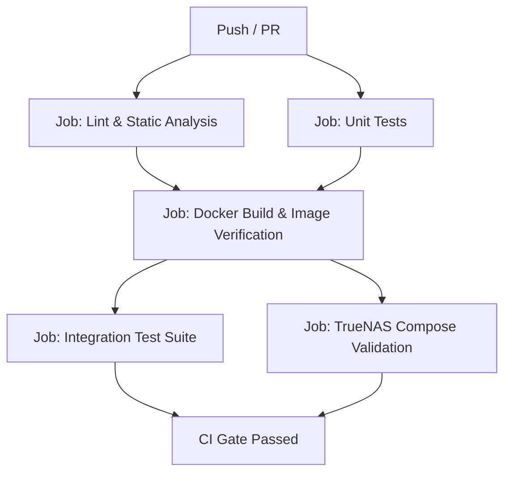

# SupaBackup Test Plan & Quality Assurance Strategy

## 1. Overview
This document specifies the test strategy, acceptance criteria verification matrix, integration test harness, and CI/CD validation gates for **SupaBackup**. 

SupaBackup is designed to run autonomously as a TrueNAS SCALE container (Apps/custom app) backing up cloud-hosted databases (PostgreSQL/Supabase and MySQL/MariaDB) to local NAS dataset mounts.

The test strategy covers:
1. **Unit Testing:** Validating isolated logic (configuration parsing, cron scheduling, retention algorithms, webhook dispatch, and health status reporting).
2. **Integration Testing:** Automated end-to-end execution against throwaway PostgreSQL 17 and MySQL 8 containers inside Docker, asserting dump creation, integrity checks (`pg_restore --list`), retention pruning, and status JSON reporting.
3. **Container & Security Validation:** Image size, client tool versions (`pg_dump` >= 15/17, `mysqldump`), non-root execution (`PUID`/`PGID` 568), and log sanitization (no credentials in stdout/stderr).
4. **TrueNAS Compose Compliance:** Automated linting of `docker-compose.yaml` to ensure compliance with TrueNAS SCALE security and storage specifications.

---

## 2. PRD Acceptance Criteria to Test Mapping

The following matrix maps every acceptance criterion from [docs/PRD.md](file:///Users/athul/Projects/SupaBackup-qa/docs/PRD.md) and design specification from [docs/ARCHITECTURE.md](file:///Users/athul/Projects/SupaBackup-qa/docs/ARCHITECTURE.md) to concrete test cases.

| PRD AC # | Requirement | Test ID | Test Name | Level | Verification Method |
| :--- | :--- | :--- | :--- | :--- | :--- |
| **AC-1** | Engine Support (PostgreSQL & MySQL/MariaDB in MVP via postgresql17-client & mariadb-client) | `TC-ENG-01`<br>`TC-ENG-02`<br>`TC-ENG-03` | Postgres Backup Execution<br>MySQL Backup Execution<br>Engine Interface Conformance | Integration<br>Integration<br>Unit | Run backup against throwaway Postgres 17 and MySQL 8 (verifying mariadb-client works against MySQL 8); verify engine interface stubs for MongoDB. |
| **AC-2** | Postgres Client Version (`pg_dump` >= 17 via `postgresql17-client`) | `TC-IMG-01` | Postgres Client Compatibility | Container / Smoke | Execute `pg_dump --version` inside the container image and assert major version >= 17. |
| **AC-3** | Container Base (Alpine minimal, non-root PUID/PGID 568 default) | `TC-SEC-01`<br>`TC-SEC-02` | Non-Root TrueNAS Permissions<br>Image Footprint Check | Integration<br>Container / Smoke | Assert process runs as UID:GID 568; verify write permissions to `/backups`; check image size < 150MB. |
| **AC-4** | Multi-Job YAML Config (url_env, webhook_url_env) & Secrets via Env / `*_FILE` | `TC-CFG-01`<br>`TC-CFG-02`<br>`TC-SEC-03` | Multi-Job Config Parsing<br>`*_FILE` Secret Resolution<br>Log Redaction / No Leaks | Unit<br>Unit & Integration<br>Integration | Load YAML with multiple jobs using `url_env`; test `*_FILE` secret resolution; assert stdout does not log connection strings or passwords. |
| **AC-5** | Built-in Cron Scheduler (no host cron) | `TC-SCH-01`<br>`TC-SCH-02` | Cron Expression Parsing<br>Scheduled Triggering | Unit<br>Integration | Unit tests for standard cron expressions (e.g. `0 2 * * *`, `@every 5s`); test job trigger dispatch in goroutine. |
| **AC-6** | Backup Output Naming & Custom Format | `TC-OUT-01`<br>`TC-OUT-02` | Output File Naming Format<br>Postgres Custom Format Check | Integration<br>Integration | Assert output filename matches `<job-name>_YYYY-MM-DD_HH-mm.dump`; verify Postgres dump header magic bytes match `PGDMP`. |
| **AC-7** | Validation & Non-Zero Exit on Failure | `TC-VAL-01`<br>`TC-VAL-02`<br>`TC-VAL-03` | Dump Integrity & Non-Empty Check<br>`pg_restore --list` Verification<br>Fault Injection (Bad Creds/Unreachable DB) | Integration<br>Integration<br>Integration | Check file size > 0; execute `pg_restore --list <dump>` and assert table schema contents; inject bad host and assert error exit & failure notification. |
| **AC-8** | Retention Policy Pruning | `TC-RET-01`<br>`TC-RET-02` | Expired Backup Pruning<br>Retention Safety Margins | Unit & Integration<br>Unit | Place simulated dumps with older timestamps (> `retention_days`); assert expired dumps are deleted and recent dumps are retained. |
| **AC-9** | Health Monitoring & Webhooks | `TC-HLT-01`<br>`TC-HLT-02`<br>`TC-NOT-01` | Status JSON Reporting<br>Docker HEALTHCHECK Execution<br>Webhook Alert Dispatch | Integration<br>Container<br>Unit & Integration | Verify `/var/run/supabackup/status.json` structure; test `HEALTHCHECK` command exits 0 on success and 1 on persistent failure; mock HTTP server verifies webhook payload. |
| **AC-10** | TrueNAS Deployment & CI Delivery | `TC-DEP-01`<br>`TC-CI-01` | TrueNAS Compose Specification Lint<br>GitHub Actions Workflow | Lint / Script<br>CI | Validate `docker-compose.yaml` against TrueNAS SCALE rules (no root, no privileged mode, bind mounts); verify CI passes clean. |

---

## 3. Test Suites & Specifications

### 3.1 Unit Testing Suite (`go test ./...`)
Unit tests are fast, in-memory tests running without external Docker dependencies.
* **`internal/config`:**
  - Valid YAML loading with single and multiple jobs.
  - Default values assignment (`PUID=568`, `PGID=568`, `retention_days=14`, `BACKUP_DIR=/backups`).
  - Resolution of `${ENV_VAR}` interpolations.
  - Resolution of `*_FILE` paths (reading secret files from `/var/run/secrets/...`).
  - Invalid configuration rejection (missing engine, malformed cron, missing url_env).
* **`internal/retention`:**
  - Filename timestamp parser handling `<job-name>_2026-10-01_02-00.dump`.
  - Date difference calculation based on `retention_days`.
  - Edge cases: directory containing unrelated files, empty directory, files with future timestamps.
* **`internal/scheduler`:**
  - Parsing valid and invalid 5-field cron expressions.
  - Concurrent job execution ensuring slow jobs do not block other jobs.
* **`internal/notify`:**
  - HTTP POST dispatch with JSON payload containing job name, timestamp, duration, status, and error details.
  - Graceful timeout handling if webhook endpoint is slow or unreachable.
* **`internal/health`:**
  - Status JSON serialization to `/var/run/supabackup/status.json`.
  - Status calculation (healthy if all scheduled jobs succeeded in last run; unhealthy on consecutive failures).

### 3.2 Integration Testing Suite (`test/run-integration-tests.sh`)
The integration test suite uses Docker Compose to orchestrate throwaway databases and runs real database backup and restore routines.

#### Integration Test Architecture:
```
+-------------------------------------------------------------------------+
| Docker Test Network (test-net)                                          |
|                                                                         |
|  +-------------------------+            +----------------------------+  |
|  | Postgres 17 (pg-source) |            | MySQL 8 (mysql-source)     |  |
|  | port: 5432              |            | port: 3306                 |  |
|  | seed: users, orders     |            | seed: customers, logs      |  |
|  +------------^------------+            +-------------^--------------+  |
|               |                                       |                 |
|               +-------------------+-------------------+                 |
|                                   |                                     |
|                      +------------+------------+                        |
|                      |  SupaBackup Container   |                        |
|                      |  (or Test Harness)      |                        |
|                      +------------+------------+                        |
|                                   |                                     |
+-----------------------------------|-------------------------------------+
                                    v
                     Mounted Volume (/backups)
                     ├── postgres-job/
                     │   ├── old_backup.dump (simulated >14d -> PRUNED)
                     │   └── postgres-job_2026-10-03_07-30.dump (VERIFIED)
                     └── mysql-job/
                         └── mysql-job_2026-10-03_07-30.sql (VERIFIED)
```

#### Test Steps Executed by Harness:
1. **Infrastructure Spin-up:**
   - Launch `postgres:17-alpine` and `mysql:8.4` (or `mysql:8.0`).
   - Poll readiness endpoints (`pg_isready -h localhost -p 5432` and `mysqladmin ping -h localhost -P 3306`).
2. **Data Seeding:**
   - Insert representative data into PostgreSQL (`CREATE TABLE users...`, 100 rows).
   - Insert representative data into MySQL (`CREATE TABLE customers...`, 50 rows).
3. **Retention Pre-seeding:**
   - Create mock backup file `postgres-job_2026-09-01_00-00.dump` (over 30 days old) in `/backups/postgres-job`.
   - Create mock backup file `postgres-job_2026-10-02_00-00.dump` (1 day old).
4. **Backup Execution:**
   - Trigger SupaBackup against `postgres-job` and `mysql-job`.
5. **Output Verification:**
   - Assert new Postgres dump exists in `/backups/postgres-job/` matching pattern `postgres-job_*.dump`.
   - Assert file size is non-zero (> 1 KB).
   - Execute `pg_restore --list` against the dump; assert tables `users` and `orders` are present in table of contents.
   - Assert new MySQL dump exists in `/backups/mysql-job/` and contains valid SQL (`CREATE TABLE \`customers\``).
6. **Retention Pruning Assertion:**
   - Verify that the 30-day-old file `postgres-job_2026-09-01_00-00.dump` was deleted.
   - Verify that the 1-day-old file `postgres-job_2026-10-02_00-00.dump` is retained.
7. **Healthcheck & Status JSON Verification:**
   - Read `/var/run/supabackup/status.json` and validate JSON schema:
     ```json
     {
       "status": "healthy",
       "jobs": {
         "postgres-job": { "last_run": "...", "status": "success", "duration_ms": 120 },
         "mysql-job": { "last_run": "...", "status": "success", "duration_ms": 150 }
       }
     }
     ```
8. **Fault Injection & Failure Handling:**
   - Configure a job pointing to an unreachable host / invalid port (`postgres-fail`).
   - Run backup; assert exit code is non-zero or failure recorded in `status.json`.
   - Verify no 0-byte corrupt dump is left on disk.

### 3.3 TrueNAS SCALE Compose Validation (`scripts/validate-truenas-compose.sh`)
TrueNAS SCALE Apps (Docker Compose "Install via YAML") imposes specific operational requirements:
* **Non-Root Execution:** TrueNAS assigns UID `568` (`apps`) and GID `568` (`apps`) to app datasets. The container must specify `user: "568:568"` or default `PUID=568` / `PGID=568`.
* **No Privileged Mode:** TrueNAS prohibits `privileged: true` for container workloads for host safety.
* **Explicit Bind Mounts:** Datasets must be mounted via host path bind mounts (e.g. `/mnt/tank/backups:/backups`).
* **Healthcheck Specification:** Container must include a defined healthcheck to allow TrueNAS UI to report application state.
* **Secret Protection:** Sensitive connection strings must use environment variables (`${VAR}`) or secrets files, never hardcoded plaintext in compose.

---

## 4. Continuous Integration (CI) Workflow Pipeline

The GitHub Actions workflow (`.github/workflows/ci.yaml`) runs on every push and PR:



### CI Jobs:
1. **`lint-and-unit`:**
   - Setup Go 1.23+
   - Run `go vet ./...`
   - Run `go test -v -race -coverprofile=coverage.out ./...`
2. **`docker-build`:**
   - Setup Docker Buildx
   - Build image `supabackup:local`
   - Run smoke checks inside image:
     - Verify `pg_dump --version` (major version >= 17)
     - Verify `mysqldump --version`
     - Verify non-root user execution (`id -u` == 568)
3. **`integration-tests`:**
   - Execute `./test/run-integration-tests.sh` using `supabackup:local`
   - Assert database seeding, dump creation, `pg_restore --list`, retention pruning, and status JSON.
4. **`truenas-validate`:**
   - Execute `./scripts/validate-truenas-compose.sh`
   - Assert compose file meets TrueNAS SCALE deployment standards.

---

## 5. Definition of Done (QA Gate)
Before merging `qa/ci` and `feat/mvp` into `main` (for Jim's final review in WFK-6):
- [x] All 10 PRD Acceptance Criteria are covered by automated tests.
- [x] Integration test harness runs cleanly against live PostgreSQL and MySQL containers.
- [x] Retention pruning is validated with real simulated timestamp files.
- [x] TrueNAS compose validation script passes with zero warnings.
- [x] CI workflow is completely defined and executable.
